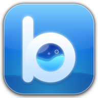
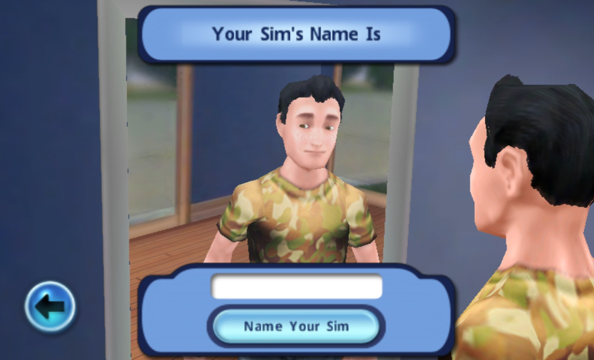
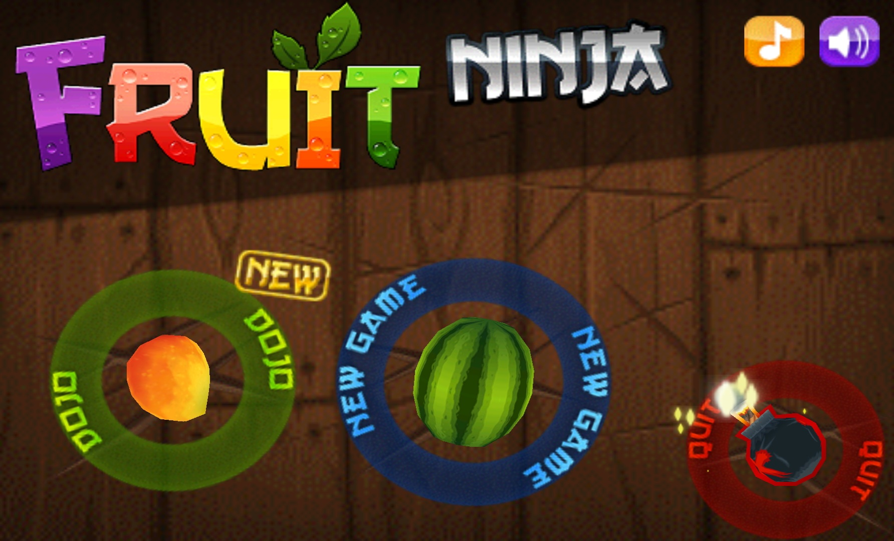
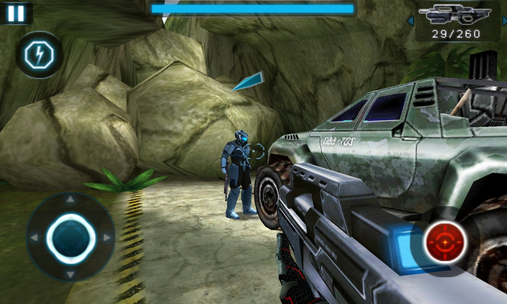

<!--
Copyright (C) 2026 Badanaut Emulator Project
SPDX-License-Identifier: Apache-2.0 OR MIT
-->

# Badanaut

  

  A high-level Samsung bada OS emulator for Linux, Windows and Android.

  

  <strong>Join our Discord for development updates, compatibility discussions, support and community chat.</strong>

---

> [!NOTE]
> Badanaut targets native 32-bit ARM Samsung bada applications packaged as `.ZIP` archives. It is experimental software: compatibility, performance and input behavior vary by game and host platform.

> [!WARNING]
> Badanaut is developed for research and educational purposes. It bundles the GNU GCC guest runtimes described below, but does not include proprietary Samsung system files, firmware or game data. Use only legally obtained game copies and archives.

## Info

Badanaut is an early-stage high-level emulator for Samsung bada games. Instead of emulating a complete bada device, it loads the original game executable, runs its ARM code through a CPU backend, and provides host-side implementations of the bada APIs the game expects.

The engine is written in C++17 and uses [Unicorn](https://github.com/unicorn-engine/unicorn) as the CPU backend. The desktop host is built with Python and Qt, and the Android host with Kotlin and SDL.

## Runtime libraries

Import a game ZIP and launch it. The native engine and desktop/Android hosts
automatically select the matching ARM32 libraries from `bada_libs/soft-float/`
or `bada_libs/hard-float/`. Both sets include `libstdc++.so.6`, `libgcc_s.so.1`
and `libsupc++.so`; games such as Angry Birds use the companions for C++
exceptions. No SDK download or runtime import is needed for a normal launch.

CMake copies `bada_libs/` beside the executable, and desktop releases and
Android APKs include the same bundle. Selection uses ARM ELF flags and
attributes; bada API 1.2 or 2.0 does not determine the float calling convention.
Native `--libstdcxx`, `--libgcc` and `--libsupcxx` options remain manual
overrides. Frontend runtime imports preserve older versions and take priority
over compatible bundled defaults.

The bundled GNU GCC 4.5.3 libraries retain GPLv3-or-later and the GCC Runtime
Library Exception 3.1. Their license texts, hashes, provenance and reproduction
instructions are in [bada_libs/README.md](bada_libs/README.md). See the
[Angry Birds compatibility notes](third_party/bada-hle/ANGRY_BIRDS.md) for
validation details.

## Games Tested

| Sims 3 | Fruit Ninja |
| :---: | :---: |
|  |  |

| Rollercoaster Rush | N.O.V.A |
| :---: | :---: |
|  |  |

